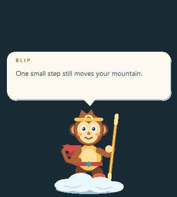

# Blip

A little Monkey King for your desktop. Blip rides a cloud along the bottom of your primary display, looks toward your cursor, and has a few kind words when you need them.



[Download a release](https://github.com/TahashiburRahman/blip/releases) · [Report a bug](https://github.com/TahashiburRahman/blip/issues) · [AI contributor guide](AGENTS.md)

## What Blip does

- Floats left and right in a transparent, frameless window above normal application windows. Empty space around the character lets clicks reach the desktop underneath.
- Looks toward the cursor within 150 pixels, sampled every 100 ms.
- Jumps, bounces, and spins a golden staff when clicked. The built-in character uses Canvas shapes; no art downloads are needed.
- Offers encouragement, jokes, and a three-emoji mood check-in from the tray. Speech bubbles disappear after four seconds.
- Hides when closed. Use **Show Blip** to restore it and **Quit** to exit. You can also right-click the character for its menu.
- Can notify you about new unread Gmail messages when you enable the integration.
- Captures the desktop on demand through **Look at screen…**, with a local preview and a **Save PNG…** button.

## Download and run

Get the archive for your platform from [GitHub Releases](https://github.com/TahashiburRahman/blip/releases). Desktop bundles include Python and the Python dependencies; a separate Python install is unnecessary.

| Platform | Launch | Support status |
| --- | --- | --- |
| Windows 10/11, x64 | Extract the whole ZIP, open `Blip`, and run `Blip.exe`. Keep `_internal` alongside it. | Desktop interactions and screen capture tested locally. |
| macOS | Extract the ZIP and open `Blip.app`. | Experimental; needs a real desktop acceptance check. |
| Linux, X11 | Extract the tar archive and run `./Blip/Blip`. Your desktop must offer a system tray. | Experimental; native Wayland is unsupported. |

Blip does not install itself at startup. Release binaries are not signed with a paid Windows signing certificate or Apple Developer ID, and are not notarized. Your operating system may require an explicit launch confirmation. The source and build instructions below are available for review.

### Run from source

Use Python **3.10–3.14**, including Tcl/Tk. On Windows and macOS, the [python.org installers](https://www.python.org/downloads/) normally include Tk. On Debian/Ubuntu with an X11 desktop:

```bash
sudo apt install python3-venv python3-tk libx11-6 libxext6 libxrandr2
```

Clone the repository and create an isolated environment:

```bash
git clone https://github.com/TahashiburRahman/blip.git
cd blip
python -m venv .venv
```

Windows PowerShell:

```powershell
.\.venv\Scripts\python.exe -m pip install .
.\.venv\Scripts\blip.exe
```

macOS / Linux:

```bash
.venv/bin/python -m pip install .
.venv/bin/blip
```

For a console during troubleshooting, run `python main.py` using the environment's Python. Blip is distributed through this repository and its releases; these instructions do not assume a published PyPI package.

## Gmail alerts

Open **Gmail settings…** from the tray, enter your Gmail address and a **Google app password**, then choose **Enable alerts**. A regular Google account password will not work. App passwords require 2-Step Verification and are unavailable for some managed or protected accounts; see [Google's instructions](https://support.google.com/accounts/answer/185833).

Alternatively, set `BLIP_GMAIL_ADDRESS` and `BLIP_GMAIL_APP_PASSWORD` in your launch environment. Blip does not load `.env` files automatically. Never commit real credentials.

Alerts start disabled on each launch. When enabled, Blip connects directly to `imap.gmail.com:993` over TLS and polls every 60 seconds, backing off after connection failures. It establishes a starting point so existing unread mail does not flood you with alerts. It opens the inbox read-only and fetches only sender/subject headers without marking messages as read. Disable the integration with **Toggle email alerts**.

Credentials entered through the dialog stay in memory for that session. Blip does not write them to a configuration file. Live Gmail access requires your own credentials; automated tests use a simulated mailbox.

## Screen access and privacy

**Look at screen…** captures only when you request it. Windows captures all monitors; macOS/Linux capture the desktop exposed by their screen service. The original image stays in memory until you explicitly save a PNG locally. Blip has no background recording, telemetry, upload endpoint, OCR, or AI model integration.

On macOS, grant Screen Recording access to Blip, or to Python/Terminal when running from source. On Linux, capture depends on Pillow's available desktop capture backend. XWayland does not guarantee correct global positioning, tracking, or capture across native Wayland applications; use an X11 session for the supported Linux path.

Diagnostic logs contain startup information and error traces, not screenshots, passwords, or email bodies. Log files rotate at 256 KiB with two backups:

| Platform | Location |
| --- | --- |
| Windows | `%LOCALAPPDATA%\Blip\blip.log` |
| macOS | `~/Library/Logs/Blip/blip.log` |
| Linux | `$XDG_STATE_HOME/blip/blip.log`, defaulting to `~/.local/state/blip/blip.log` |

Review logs for personal paths before attaching them to a public issue.

## Optional spritesheet

```bash
python main.py --sprites spritesheet.png --frame-width 128 --frame-height 128 --sprite-fps 8
```

Use a transparent PNG with equal-sized frames, read left to right and then top to bottom. Without explicit sizes, Blip assumes square frames as tall as the sheet. The frame grid must divide the image exactly; at most 256 frames are accepted. Supplied art replaces the built-in character rig: directional eye and staff details must be represented in your artwork. Walking, mirroring, jumping, tray commands, and speech bubbles still work.

## Develop and test

All runtime application logic remains in [`main.py`](main.py). Build and packaging helpers live in `scripts/` and `Blip.spec`.

```bash
python -m pip install -r requirements-dev.txt
python -m ruff check .
python -m unittest discover -v
python -m build
python -m twine check dist/*.whl dist/*.tar.gz
```

The default tests do not open windows, contact Gmail, or capture your desktop. The opt-in desktop suite opens a real tray/window and performs one in-memory desktop capture. Run it only in an interactive desktop session:

```powershell
# Windows PowerShell
$env:BLIP_GUI_TESTS = "1"
python -m unittest -v test_main
```

```bash
# macOS / Linux X11
BLIP_GUI_TESTS=1 python -m unittest -v test_main
```

### Build desktop downloads

```bash
python -m pip install -r requirements-dev.txt
python scripts/build.py
```

Build on the target operating system. PyInstaller is a build-time dependency; the app's direct runtime dependencies remain Pillow and pystray. Outputs go in `dist/`, with a platform archive, `SHA256SUMS`, dependency license notices, and build metadata. Extract the whole archive before running it. Third-party dependencies retain their upstream licenses.

CI checks Python versions across Windows, macOS, and Linux. The release workflow builds platform bundles and creates a GitHub release when a version tag is pushed. Follow [the release checklist](docs/releasing.md) before tagging; a successful build alone does not establish that an untested desktop platform works.

## Contribute

Read [CONTRIBUTING.md](CONTRIBUTING.md) and [AGENTS.md](AGENTS.md). Keep screenshots and credentials out of commits. For a sensitive security report, follow [SECURITY.md](SECURITY.md).

Blip's source is available under the [MIT license](LICENSE). Sun Wukong is a traditional character; the built-in artwork is drawn by this project.
